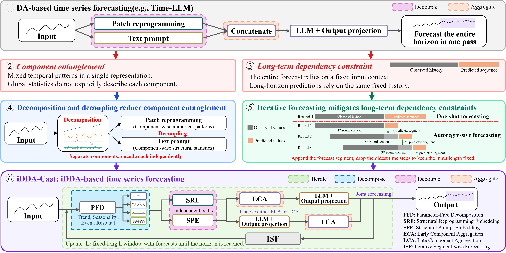

# iDDA-Cast: Iterative Decompose–Decouple–Aggregate for Time Series Forecasting

This repository provides the implementation of **iDDA-Cast**, a large language model (LLM)-based time series forecasting framework designed to address component entanglement and long-horizon dependency constraints in existing Decouple-and-Aggregate (DA) approaches.

iDDA-Cast introduces an iterative Decompose–Decouple–Aggregate architecture that explicitly models heterogeneous temporal patterns and updates the forecasting context across successive prediction segments.

The framework consists of five principal components:

- **PFD (Parameter-Free Decomposition):** Decomposes a time series into trend, seasonal, event, and residual components without introducing additional learnable decomposition parameters.
- **SRE (Structural Reprogramming Embedding):** Converts component-specific numerical patterns into representations compatible with a pretrained LLM.
- **SPE (Structural Prompt Embedding):** Constructs component-aware prompts using global statistics and structural characteristics such as trend changes, periodicity, event occurrences, and residual fluctuations.
- **ECA and LCA (Early and Late Component Aggregation):** Provide two aggregation strategies for modeling component interactions or preserving component independence.
- **ISF (Iterative Segment-wise Forecasting):** Generates future predictions in successive segments while updating the input context with preceding predictions.

Two forecasting variants are provided:

**iDDA-ECA** combines component representations before LLM processing, allowing interactions among structural components.

**iDDA-LCA** processes component representations independently through the LLM and aggregates their predictions afterward.



*Figure 1. Overview of the iDDA-Cast framework.*

## License

This project is distributed under the [Apache License 2.0](LICENSE), subject to the applicable terms of incorporated third-party components.

The implementation builds upon the [Time-LLM](https://github.com/KimMeen/Time-LLM) framework. Original copyright notices and attribution requirements are retained where applicable.

Some incorporated third-party files may have separate licensing conditions. For example, `utils/losses.py` contains a CC BY-NC 4.0 notice associated with N-BEATS code from Element AI Inc. If included, that file remains subject to its applicable license conditions.

See [LICENSE](LICENSE) and [LEGAL.md](LEGAL.md) for further information.

## Installation

iDDA-Cast is implemented using Python, PyTorch, Hugging Face Transformers, and Accelerate.

The representative experimental environment is:

| Package | Version |
|---|---|
| Python | 3.10 |
| PyTorch | 2.2.2 |
| Transformers | 4.31.0 |
| Accelerate | 0.28.0 |
| DeepSpeed | 0.14.0 |
| NumPy | 1.23.5 |
| Pandas | 1.5.3 |

The released dependency files should be checked against the environment used for the final experiments.

Clone the repository:

```bash
git clone https://github.com/YOUR_USERNAME/iDDA-Cast.git
cd iDDA-Cast
```

Create a Python environment and install the dependencies:

```bash
conda create -n idda-cast python=3.10 -y
conda activate idda-cast
pip install -r requirements.txt
```

A CUDA-compatible PyTorch installation is required for GPU training. The exact CUDA and dependency versions should match the selected hardware and LLM backbone.

## Datasets

We evaluate iDDA-Cast on multivariate time series forecasting datasets covering electricity transformer measurements, weather, exchange rates, wind, and healthcare-related observations.

| Dataset | Frequency | Variables | Description |
|---|---|---:|---|
| ETTh1 | 1 hour | 7 | Electricity transformer temperature |
| ETTh2 | 1 hour | 7 | Electricity transformer temperature |
| ETTm1 | 15 minutes | 7 | Electricity transformer temperature |
| ETTm2 | 15 minutes | 7 | Electricity transformer temperature |
| Weather | 1 hour | 21 | Meteorological observations |
| Exchange | 1 day | 8 | Foreign exchange rates |
| Wind | 15 minutes | 7 | Wind measurements |
| ILI | 1 week | 7 | Influenza-like illness observations |

Additional dataset configurations, including air-quality data, may be supported through dataset-specific loaders and experimental scripts.

The original datasets should be obtained from their respective sources and placed in the `dataset/` directory.

For example:

```text
dataset/
├── ETT-small/
│   ├── ETTh1.csv
│   ├── ETTh2.csv
│   ├── ETTm1.csv
│   └── ETTm2.csv
├── weather/
│   └── weather.csv
├── exchange_rate/
│   └── exchange_rate.csv
└── prompt_bank/
    ├── ETT.txt
    ├── Weather.txt
    └── Exchange.txt
```

Other dataset directories and prompt files should follow the paths expected by the corresponding data loaders and experiment scripts.

## Experimental Results

We compare iDDA-Cast with established forecasting models, including **Time-LLM, AutoTimes, FPT, PatchTST, TimesNet, and DLinear**.

Forecasting performance is evaluated using Mean Squared Error (MSE) and Mean Absolute Error (MAE), where lower values indicate better forecasting accuracy.

In the current manuscript's reported evaluation, iDDA-Cast achieves the best forecasting accuracy in **18 of 24 forecasting configurations**, with a maximum prediction-error reduction of **9.65%** compared with Time-LLM.

The complete benchmark results should be reported using the finalized experimental table.

### Component Ablation Study

We examine the contribution of the four structural components by individually removing trend, seasonal, event, and residual information from iDDA-LCA.

The following table summarizes representative ETTh1 results.

| Configuration | MSE (96) | MSE (192) |
|---|---:|---:|
| iDDA-LCA | **0.3710** | **0.3979** |
| w/o Trend | 0.4331 | 0.4729 |
| w/o Seasonal | 0.5100 | 0.5391 |
| w/o Event | 0.3858 | 0.4295 |
| w/o Residual | 0.4223 | 0.4505 |

Removing individual components increases prediction errors, supporting the importance of component-specific temporal modeling. In these experiments, removing seasonality produces the largest degradation.

### Module Ablation Study

We further evaluate the contributions of the structural embedding and iterative forecasting modules.

| Configuration | MSE (96) | MSE (192) |
|---|---:|---:|
| iDDA-LCA | **0.3720** | **0.3979** |
| w/o SRE | 0.7391 | 0.7378 |
| w/o SPE | 0.3729 | 0.4112 |
| w/o ISF | 0.3727 | 0.4016 |

SRE has the largest measured impact in this ablation setting, while SPE and ISF also contribute to forecasting performance.

*The main benchmark and ablation results originate from their respective experimental configurations and should be reconciled with the final paper tables before release.*

## Quick Start

The following examples demonstrate how to train iDDA-LCA and iDDA-ECA on ETTh1.

All commands should be executed from the repository root.

The examples assume that `iDDA-LCA` and `iDDA-ECA` are registered as separate model identifiers in `run_main.py`.

### 1. Prepare the dataset

Place `ETTh1.csv` in:

```text
dataset/ETT-small/ETTh1.csv
```

Ensure that the corresponding dataset prompt file is available under `dataset/prompt_bank/`.

### 2. Run iDDA-LCA

For ETTh1 with input length 512 and prediction length 96:

```bash
CUDA_VISIBLE_DEVICES=0 accelerate launch \
  --mixed_precision fp16 \
  --num_processes 1 \
  run_main.py \
  --task_name long_term_forecast \
  --is_training 1 \
  --model iDDA-LCA \
  --model_id ETTh1_512_96_LCA \
  --model_comment iDDA-LCA_ETTh1_96 \
  --data ETTh1 \
  --root_path ./dataset/ETT-small/ \
  --data_path ETTh1.csv \
  --features M \
  --target OT \
  --freq h \
  --embed timeF \
  --seq_len 512 \
  --label_len 48 \
  --pred_len 96 \
  --ar_len 96 \
  --enc_in 7 \
  --dec_in 7 \
  --c_out 7 \
  --llm_model GPT2 \
  --llm_dim 768 \
  --llm_layers 6 \
  --d_model 32 \
  --d_ff 128 \
  --n_heads 8 \
  --patch_len 16 \
  --stride 8 \
  --seasonal_patch_len 12 \
  --seasonal_stride 6 \
  --batch_size 8 \
  --learning_rate 0.0001 \
  --train_epochs 5 \
  --prompt_domain 1 \
  --component_eval 0
```

### 3. Run iDDA-ECA

iDDA-ECA uses the same forecasting configuration with the early aggregation model.

Replace the model-related arguments as follows:

```bash
--model iDDA-ECA
--model_id ETTh1_512_96_ECA
--model_comment iDDA-ECA_ETTh1_96
```

All other arguments can remain unchanged for a controlled comparison.

### 4. Run different forecasting horizons

The main forecasting experiments use prediction lengths of 96, 192, and 336.

Change the following argument:

```bash
--pred_len 192
```

or:

```bash
--pred_len 336
```

The ISF segment length can remain fixed at:

```bash
--ar_len 96
```

For dataset-specific forecasting configurations, use the corresponding experiment scripts when available in the repository.

## Baseline Models

We compare iDDA-Cast with the following representative forecasting models.

| Model | Description |
|---|---|
| Time-LLM | LLM-based forecasting with reprogramming and prompting |
| AutoTimes | Autoregressive forecasting using pretrained language models |
| FPT | Frozen pretrained Transformer-based forecasting |
| PatchTST | Patch-based Transformer for time series forecasting |
| TimesNet | Temporal variation modeling using two-dimensional transformations |
| DLinear | Linear forecasting using time series decomposition |

Comparisons should use consistent data splits, forecasting horizons, and evaluation protocols.

## File Descriptions

The following files and directories constitute the principal implementation components.

| File or Directory | Description |
|---|---|
| `run_main.py` | Main training and evaluation entry point |
| `models/TimeLLM.py` | Time-LLM baseline implementation |
| `models/iDDA-ECA.py` | iDDA-Cast with early component aggregation |
| `models/iDDA-LCA.py` | iDDA-Cast with late component aggregation |
| `models/` | Forecasting baseline implementations |
| `layers/` | Shared neural network and embedding layers |
| `data_provider/` | Dataset loading and preprocessing |
| `utils/` | Evaluation metrics, learning utilities, and supporting functions |
| `scripts/` | Dataset-specific experimental commands |
| `dataset/prompt_bank/` | Dataset-dependent textual descriptions |
| `ds_config_zero2.json` | DeepSpeed ZeRO configuration |
| `requirements.txt` | Python dependencies |
| `environment.yml` | Conda environment configuration |
| `LICENSE` | Apache License 2.0 text |
| `LEGAL.md` | Additional legal information |

The model file names shown above should match the actual public repository. The model registration logic in `run_main.py` must select the correct model implementation.

## Reproducing the Paper Results

The representative iDDA-Cast forecasting configuration is:

| Parameter | Value |
|---|---|
| LLM Backbone | GPT-2 |
| LLM Layers | 6 |
| Input Length | 512 |
| Label Length | 48 |
| Prediction Length | 96 / 192 / 336 |
| ISF Segment Length | 96 |
| Batch Size | 8 |
| Learning Rate | 1e-4 |
| Model Dimension | 32 |
| Feed-Forward Dimension | 128 |
| TER Patch Length / Stride | 16 / 8 |
| Seasonal Patch Length / Stride | 12 / 6 |

These settings represent the primary forecasting configuration. Dataset-specific settings and individual experiments may differ.

For example, Exchange uses a seasonal patch length and stride of 7/7, while Wind uses seasonal patch length and stride of 72/24 in the recorded experimental configuration.

### Evaluation Protocol

To reproduce the experimental results:

1. Download and prepare the required datasets.
2. Configure the Python environment and pretrained LLM backbone.
3. Select iDDA-LCA or iDDA-ECA.
4. Set the dataset-specific parameters and prediction horizon.
5. Train the selected model and evaluate its forecasting performance.
6. Record MSE and MAE using the evaluation protocol associated with the experiment.

The supplied training implementation evaluates the final training epoch rather than automatically restoring the best validation checkpoint. This distinction should be preserved when comparing results.

For the reported paper results, use the exact training settings, random seeds, and evaluation procedures specified in the corresponding experimental configuration.

## Acknowledgments

This implementation builds upon the open-source [Time-LLM](https://github.com/KimMeen/Time-LLM) framework.

We thank the original Time-LLM authors for making their research and implementation publicly available.

iDDA-Cast extends the underlying forecasting framework through explicit structural decomposition, component-wise reprogramming and prompting, early and late aggregation strategies, and iterative segment-wise forecasting.

We also acknowledge the authors of the baseline forecasting methods and third-party libraries incorporated into this repository.

Original copyright and license notices are retained where applicable, and modifications to upstream source files should be identified in the released code.

## Citation

If you use iDDA-Cast in your research, please cite the corresponding paper when its bibliographic information becomes available.

Citation information will be updated upon publication.